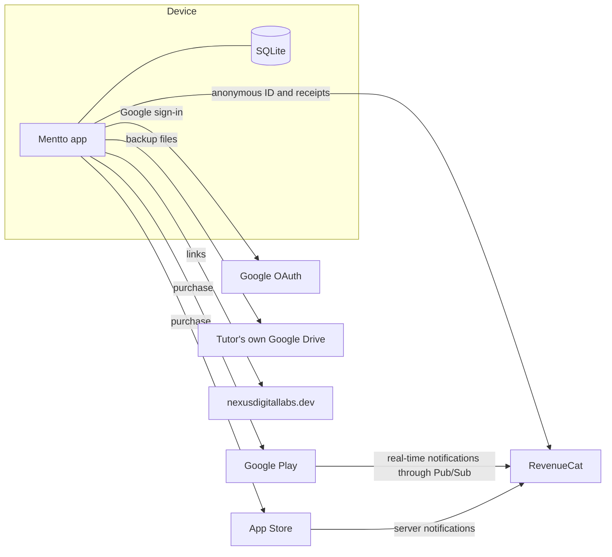

# Third-party services and integrations

Every outside service Mentto depends on, how it's connected and what happens without it. This file holds identifiers only.
**Secrets are never committed**; see [Secrets](#secrets-and-where-they-live).

There's no line to a Mentto server, because there isn't one. Student records only leave the phone in the tutor's own Drive
backup, or in something the tutor chooses to share.

## Summary

| Service | Used for | If it's down or missing |
|---|---|---|
| Google Play | Android distribution and payments | Android purchases fail; the app still works |
| App Store | iOS distribution and payments | iOS purchases fail; the app still works |
| RevenueCat | Validates purchases, holds the `pro` entitlement | New purchases fail, and a failed entitlement check reads as not Pro; records aren't affected |
| Google OAuth and Drive | Optional backup and restore | Backup waits and retries; the app still works |
| nexusdigitallabs.dev | Marketing page and privacy policy | Links fail; stores can reject a listing without a working policy |

Mentto has **no** ads, analytics, crash-reporting or attribution SDKs. Adding one would mean updating the privacy policy, Play
Data safety and App Privacy.

## Accounts

| Service | Account |
|---|---|
| Google Play Console | NexusDigitalLabs studio account |
| Google Cloud | Project `mentto-511807` |
| RevenueCat | Project **Mentto** (separate from Odova) |
| Apple Developer, App Store Connect | Personal individual account, team `S3NGY3A2RA` |
| GitHub | `dilanfdo/mentto`, personal SSH key |
| Website | `NexusDigitalLabs/nexusdigitallabs.github.io` |

**Never use a LetsBridge account, team, certificate or email for any of this.**

Because the Apple account is an individual one, the App Store shows the enrolled person's legal name as the seller. Showing a
company name would need a new organization enrollment and an app transfer, which keeps reviews and the bundle ID.

## RevenueCat

**Code:** `src/billing/purchases.ts`, using `react-native-purchases`. The SDK is configured once with the public key for the
platform.

| Object | Value |
|---|---|
| Entitlement | `pro` (must match `REVENUECAT_ENTITLEMENT_ID`) |
| Offering | `default`, set as current |
| Android app | `Mentto (Android)`, public key `goog_...` |
| iOS app | `Mentto (App Store)`, public key `appl_...` |

| Package | Google Play product | App Store product | USD |
|---|---|---|---|
| `$rc_monthly` | `mentto_pro:monthly` | `mentto_pro_monthly` | 3.99 |
| `$rc_annual` | `mentto_pro:yearly` | `mentto_pro_yearly` | 29.99 |
| `$rc_lifetime` | `mentto_pro_lifetime` | `mentto_pro_lifetime` | 59.99 |

**Connected to Google Play by:** service account `revenuecat@mentto-511807.iam.gserviceaccount.com`, with Pub/Sub Admin and
Monitoring Viewer in Cloud, and financial, order and subscription permissions in Play Console. Its JSON key is uploaded to
RevenueCat. Real-time notifications use the Pub/Sub topic `projects/mentto-511807/topics/Play-Store-Notifications`.

**Connected to Apple by:** an In-App Purchase key (`.p8`), uploaded to RevenueCat with its key ID and issuer ID. The key works
across the Apple team, so the one made for Odova can be reused. RevenueCat's Apple notification URL is set in App Store Connect for
Production and Sandbox.

**Dashboard notes:**
- Apple products were added by hand, so they show **"Could not check"**. That only means RevenueCat has no App Store Connect API
  key to read them with, and purchases aren't affected.
- Test purchases only appear with **Sandbox data** on.
- Changing prices or swapping products in the offering doesn't need an app build, unless a new package type is added.

## Google Play

| Item | Value |
|---|---|
| Subscription | `mentto_pro`, base plans `monthly` and `yearly` |
| Free trial | Offer `trial-7d` on each base plan |
| One-time product | `mentto_pro_lifetime` |
| Pricing | USD base with Google's conversion |

Signing: the upload key signs the bundle, and Play App Signing re-signs it for users. Listing and declarations are in
[PLAY_STORE.md](./PLAY_STORE.md).

## App Store

| Item | Value |
|---|---|
| Bundle ID | `app.nexusdigitallabs.mentto` |
| SKU | `mentto-ios-001` |
| Subscription group | `Mentto Pro`. Yearly should be level 1 and monthly level 2, so moving to yearly is an upgrade |
| Subscriptions | `mentto_pro_monthly`, `mentto_pro_yearly`, each with a 1-week free introductory offer |
| Non-consumable | `mentto_pro_lifetime` |
| App price | Free. Pro prices are set on the products, and paying for the app itself would contradict the listing |
| Availability | All except the 27 EU storefronts, because the account is a declared DSA non-trader |

Test purchases in TestFlight use Apple's sandbox, at no charge. To retest a free trial, use a sandbox tester and clear its purchase
history. Listing text and privacy answers are in [ios-app-store-listing.md](./ios-app-store-listing.md).

Sign in with Apple isn't needed: Google sign-in only reaches the tutor's Drive and isn't an app login, so guideline 4.8 doesn't apply.

## Google sign-in and Drive

**Code:** `src/backup/account.ts`, `src/backup/drive.ts`. **Project:** `mentto-511807`.

| Item | Value |
|---|---|
| Consent screen | External, in production |
| Scope | `https://www.googleapis.com/auth/drive.appdata` only (non-sensitive, no Google verification) |
| Storage | Drive's hidden `appDataFolder`: the tutor can't browse it, and Mentto can't see their other files |

| OAuth client | Identified by |
|---|---|
| `Mentto Android (debug)` | Package + debug key SHA-1 |
| `Mentto Android (Play)` | Package + Play App Signing SHA-1 |
| `Mentto Android (upload)` | Package + upload key SHA-1, for sideloaded release builds |
| `Mentto iOS` | Bundle ID; the client ID is compiled into the app, with its reversed form as a URL scheme |

The SHA-1 values are in [PLAY_STORE.md, Part 7](./PLAY_STORE.md). **`appDataFolder` belongs to the Google Cloud project**, so
keep all clients in this one project, or the two platforms won't see each other's backups.

| Symptom | Cause |
|---|---|
| Android: error 10, `DEVELOPER_ERROR` | No client for the installed build's SHA-1 |
| Works sideloaded, fails from Play | Only the upload key has a client |
| "Access blocked" | Consent screen back in Testing |
| iOS: "Google sign-in isn't available in this build" | Built without `EXPO_PUBLIC_GOOGLE_IOS_CLIENT_ID` |
| `ASYNC_OP_IN_PROGRESS` | Overlapping `getTokens()` calls; `getAccessToken()` shares one request to prevent it |

### Restoring sign-in on a new phone

Google Play requires apps with sign-in, even optional sign-in, to restore it on a new phone from April 2027
([zero-tap sign-in restoration](https://support.google.com/googleplay/android-developer/answer/17492799)). Play measures this
by whether a restore key can be retrieved. `modules/restore-key/` handles it with Credential Manager, on Android 9 and up:

| Moment | What happens |
|---|---|
| Sign-in, or a launch while signed in | Saves a key once per install, backed up to the cloud where possible, otherwise kept for a cable transfer |
| First launch of an install | Reads the key. If the sign-in file didn't move too, it passes the account to a silent Google sign-in |
| Backup on, but the data didn't move | Reconnects backup. Drive is checked first, so an existing backup is offered, never overwritten |
| Backup turned off, or Google ended the session | Deletes the key |

**There is no server, unlike Google's guide.** Its guide proves the key to a relying party server, but here the key grants
nothing. It only names the account, held in the WebAuthn `user.id`, and the Drive token still comes from Google, for an account
already on the phone. The key's signature is never checked, and no `assetlinks.json` is needed. The relying party ID is
`nexusdigitallabs.dev`; don't change it, or keys already on phones can't be found. Addresses over 64 bytes get no key, so
those tutors sign in by hand.

The "saved" and "checked" markers are in `noBackupFilesDir`, so they don't move with the app. Tested with simulated moves on an
emulator; a real cable or cloud transfer between two phones is still untested.

## Website

Repo `NexusDigitalLabs/nexusdigitallabs.github.io`, served at `nexusdigitallabs.dev`.

| Page | Path in that repo | Linked from |
|---|---|---|
| `/mentto/` | `src/app/mentto/page.tsx` | Settings, store listings |
| `/mentto/privacy-policy/` | `src/app/mentto/privacy-policy/page.tsx` | Settings, paywall, backup sign-in, store listings, OAuth consent |
| `/contact/` | | Support URL |

**Keep the policy in step with the app.** It describes data flows, so it must change along with Data safety and App Privacy
whenever an SDK or data flow changes. On launch, `/mentto/` needs its "iPhone · coming soon" pill replaced by an App Store link.

## Expo

Used as a framework and for `expo prebuild`. No EAS Build, Submit or Update is used, so no Expo account is needed to ship.
If one is ever added, use the `dilanfdo.dev` account and never let it choose an Apple team on its own.

## Secrets and where they live

| Secret | Where | Note |
|---|---|---|
| Android keystore and passwords | `~/.mentto-signing/` | **Losing it** means asking Google for an upload key reset. Back it up |
| Google service account JSON | Local copy, and in RevenueCat | Can be replaced with a new key in Cloud |
| Apple In-App Purchase key (`.p8`) | Personal `Files` folder, and in RevenueCat | Apple allows one download only |
| Xcode signing certificates | Mac keychain, managed by Xcode | Can be recreated |

These are public and safe to ship, though not all are in the repo: RevenueCat `goog_` and `appl_` keys, Google client IDs and the
Apple team ID. A RevenueCat `sk_` key is a real secret, and the app doesn't use one.

**Gitignored:** `.env*.local`, `*.jks`, `*.p8`, `*.p12`, `*.key`, `*.pem`, `*.mobileprovision`, `android/`, `ios/`.

**Setting up a new Mac:** restore `~/.mentto-signing/`, sign in to Xcode with the personal Apple ID, and recreate
`.env.production.local` from [ios-release.md](./ios-release.md#4-local-settings). The two public keys can be copied again from
RevenueCat and Google Cloud.

## Open-source packages

Licences are the packages' own. The main ones are in `package.json`:

| Package | Used for |
|---|---|
| `expo-*` | SQLite, notifications, fonts, print, sharing, file system, crypto, localization, router |
| `react-native-purchases` | RevenueCat SDK |
| `@react-native-google-signin/google-signin` | Google sign-in |
| `@react-native-community/netinfo` | Knowing when to retry a backup |
| `@react-native-community/datetimepicker` | Date and time pickers |
| `react-native-reanimated`, `react-native-worklets` | Animation |
| `fflate` | Gzip for backup files |
| Plus Jakarta Sans | Bundled font (SIL Open Font License) |
